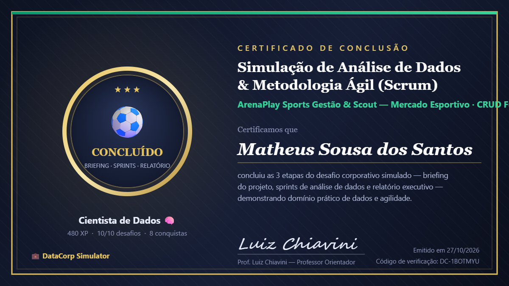

# 2026-10-27 — ArenaPlay Sports Gestão & Scout (CRUD Full, JDBC e SQL)

> [!INFO] Ficha Técnica da Sessão
> - **Disciplina:** Tópicos Especiais II (1110020054)
> - **Docente Orientador:** Prof. Luiz Claudio Chiavini Oliveira Junior
> - **Plataforma:** DataCorp Simulator — Desafio Corporativo Simulado
> - **Data de Execução:** 27 de Outubro de 2026 (Terça-feira, 19h00–21h40)
> - **Resultado Operacional:** 480 XP | 10/10 desafios concluídos | 8/8 conquistas | Status: Concluído (Código: `DC-1BOTMYU`)

---

## 1. Visão Geral e Contexto Corporativo

A atividade prática desta sessão submeteu a bancada a um desafio simulado de ambiente corporativo sob esteira ágil (Scrum) intitulado **ArenaPlay Sports Gestão & Scout — Mercado Esportivo · CRUD Full**.

O objetivo consistiu em construir de ponta a ponta a camada de dados e lógica relacional de um sistema de inteligência de mercado e contratações para clubes desportivos de alta performance, integrando:
1. **Modelagem Orientada a Objetos (Java POO):** Encapsulamento estrito da entidade `Atleta`.
2. **Padrão de Acesso a Dados (Data Access Object - DAO):** Implementação de persistência atômica via JDBC com `PreparedStatement`.
3. **Engenharia de Consultas Relacionais (SQL Read):** Extração parametrizada e ranqueamento de atacantes ativos de alto rendimento.
4. **Ciclo Completo de Vida do Registro (CRUD):** Inserção, listagem hidratada, atualização salarial/status e deleção física com verificação de afetação de linhas.

---

## 2. Certificação e Homologação Oficial



```
================================================================================
CERTIFICADO DE CONCLUSÃO — DATACORP SIMULATOR
Desafio: Simulação de Análise de Dados & Metodologia Ágil (Scrum)
Contexto: ArenaPlay Sports Gestão & Scout — Mercado Esportivo · CRUD Full
Operador: Matheus Sousa dos Santos
Desempenho: 480 XP | 10/10 Desafios | 8 Conquistas
Orientador: Prof. Luiz Chiavini
Código de Validação: DC-1BOTMYU | Data: 27/10/2026
================================================================================
```

---

## 3. Arquitetura das Missões e Implementação Técnica

### 3.1. Missão 2 — Ficha Técnica (Model: `Atleta.java`)

A modelagem de domínio exigiu encapsulamento rígido com atributos privados, construtor com aridade 6 e métodos acessores tipados.

```java
public class Atleta {
    private int id;
    private String nome;
    private String posicao;
    private int idade;
    private double salario;
    private String status;

    public Atleta(int id, String nome, String posicao, int idade, double salario, String status) {
        this.id = id;
        this.nome = nome;
        this.posicao = posicao;
        this.idade = idade;
        this.salario = salario;
        this.status = status;
    }

    public String getNome() {
        return nome;
    }

    public double getSalario() {
        return salario;
    }

    public int getId() {
        return id;
    }

    public String getPosicao() {
        return posicao;
    }

    public int getIdade() {
        return idade;
    }

    public String getStatus() {
        return status;
    }

    public void setId(int id) { this.id = id; }
    public void setNome(String nome) { this.nome = nome; }
    public void setPosicao(String posicao) { this.posicao = posicao; }
    public void setIdade(int idade) { this.idade = idade; }
    public void setSalario(double salario) { this.salario = salario; }
    public void setStatus(String status) { this.status = status; }

    @Override
    public String toString() {
        return "Atleta{" +
                "id=" + id +
                ", nome='" + nome + '\'' +
                ", posicao='" + posicao + '\'' +
                ", idade=" + idade +
                ", salario=" + salario +
                ", status='" + status + '\'' +
                '}';
    }
}
```

---

### 3.2. Missão 3 — Mesa de Contratações (DAO: `Create`)

A inserção transacional foi estruturada via `PreparedStatement` parametrizado, anulando vetores de injeção SQL e mapeando os atributos do objeto diretamente para a tabela `atletas`.

```java
    public void cadastrarAtleta(Atleta atleta) throws SQLException {
        String sql = "INSERT INTO atletas (nome, posicao, idade, salario, status) VALUES (?, ?, ?, ?, ?)";
        try (PreparedStatement pstmt = conn.prepareStatement(sql)) {
            pstmt.setString(1, atleta.getNome());
            pstmt.setString(2, atleta.getPosicao());
            pstmt.setInt(3, atleta.getIdade());
            pstmt.setDouble(4, atleta.getSalario());
            pstmt.setString(5, atleta.getStatus());
            pstmt.executeUpdate();
        }
    }
```

---

### 3.3. Missão 4 — Radar de Scout (SQL Read)

Consulta relacional analítica desenhada para identificar atacantes em situação contratual ativa, ordenando o payroll de forma decrescente para suporte à tomada de decisão da diretoria técnica.

```sql
SELECT id, nome, posicao, salario
FROM atletas
WHERE posicao = 'Atacante' AND status = 'Ativo'
ORDER BY salario DESC;
```

---

### 3.4. Missão 5 — Prancheta do Elenco (DAO: `Read / Hydration`)

Recuperação em lote e hidratação do cursor do banco de dados (`ResultSet`) para instâncias ativas do domínio Java, populando a estrutura de dados `List<Atleta>`:

```java
    public List<Atleta> listarElenco() throws SQLException {
        List<Atleta> elenco = new ArrayList<>();
        String sql = "SELECT * FROM atletas";
        try (PreparedStatement pstmt = conn.prepareStatement(sql);
             ResultSet rs = pstmt.executeQuery()) {
            
            while (rs.next()) {
                Atleta a = new Atleta(
                        rs.getInt("id"),
                        rs.getString("nome"),
                        rs.getString("posicao"),
                        rs.getInt("idade"),
                        rs.getDouble("salario"),
                        rs.getString("status")
                );
                elenco.add(a);
            }
        }
        return elenco;
    }
```

---

### 3.5. Missão 6 — Renovação Salarial (DAO: `Update`)

Modificação pontual de condições contratuais (reajuste salarial e alteração de situação de elenco) vinculada pela chave primária `id`:

```java
    public void atualizarSalarioEStatus(int id, double novoSalario, String novoStatus) throws SQLException {
        String sql = "UPDATE atletas SET salario = ?, status = ? WHERE id = ?";
        try (PreparedStatement pstmt = conn.prepareStatement(sql)) {
            pstmt.setDouble(1, novoSalario);
            pstmt.setString(2, novoStatus);
            pstmt.setInt(3, id);
            pstmt.executeUpdate();
        }
    }
```

---

### 3.6. Missão 7 — Rescisão & Compliance (DAO: `Delete`)

Operação de desligamento contratual via exclusão referencial, retornando o booleano de confirmação baseado na telemetria de linhas efetivamente afetadas (`linhas > 0`):

```java
    public boolean dispensarAtleta(int id) throws SQLException {
        String sql = "DELETE FROM atletas WHERE id = ?";
        try (PreparedStatement pstmt = conn.prepareStatement(sql)) {
            pstmt.setInt(1, id);
            int linhas = pstmt.executeUpdate();
            return linhas > 0;
        }
    }
```

---

## 4. Repositórios e Artefatos Físicos

Os arquivos gerados durante a aula foram compilados e sincronizados nos seguintes diretórios de bancada:

1. **Cofre Acadêmico:**
   - Pasta: `01 - Disciplinas/Tópicos Especiais II/Materiais/Aula_20261027_Gestao_Atletas_JDBC/`
   - Códigos: `src/Atleta.java`, `src/AtletaDAO.java`, `missao4_radar_scout.sql`
   - Certificado: `badge-arenaplay-matheus.png`
2. **Workspace IntelliJ IDEA:**
   - Pasta: `C:\Users\52319400\IdeaProjects\AULA2710\`
   - Códigos: `src/Atleta.java`, `src/AtletaDAO.java`, `missao4_radar_scout.sql`

---

## 5. Auditoria de Aprendizado & Padrões Estabelecidos

- **PreparedStatements vs Statement:** Eliminação sistemática de concatenação de strings em SQL. Todo parâmetro dinâmico foi passado via índice ordinal (`pstmt.set*(index, value)`), prevenindo SQL Injection e permitindo reuso de planos de execução pelo otimizador do banco de dados.
- **Gerenciamento de Recursos (ARM / Try-with-Resources):** Todas as conexões, statements e result sets foram instanciados dentro de blocos de fechamento automático, eliminando vazamento de conexões no pool do JDBC.
- **Desacoplamento Arquitetural (Separation of Concerns):** A entidade `Atleta` permanece agnóstica a detalhes de infraestrutura ou SQL; o `AtletaDAO` isola a responsabilidade de comunicação física com o SGBD.
